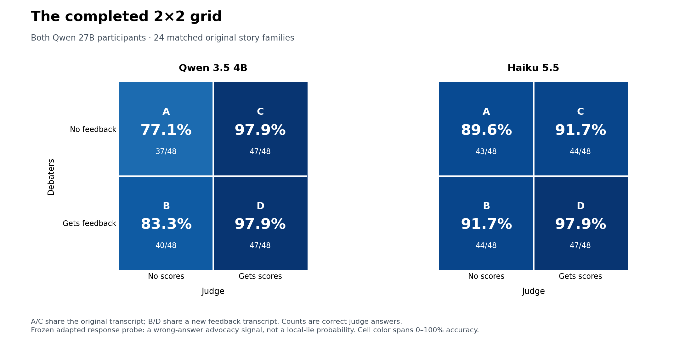
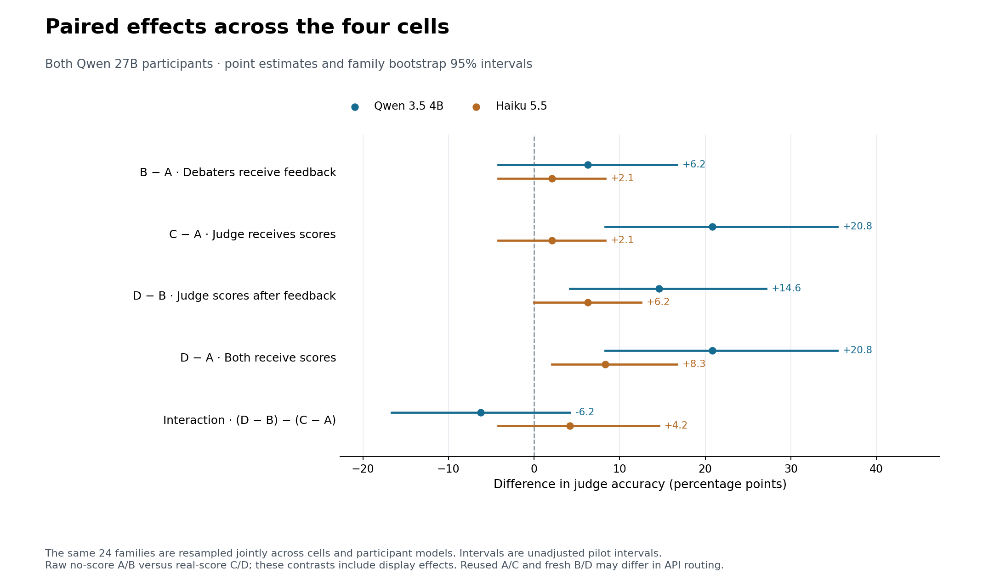
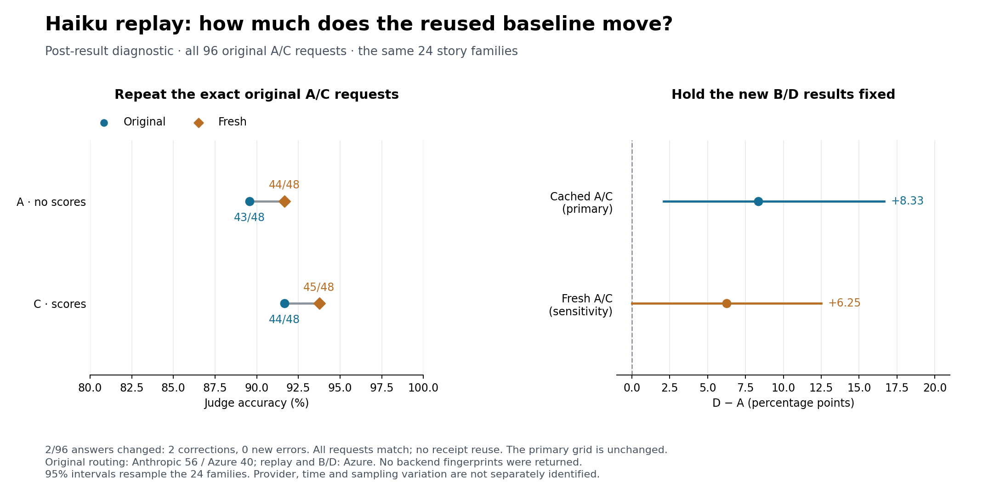

# Probity iteration 4 — the matched feedback grid

The complete grid retains the same **24 original story families**, each with
Qwen3.5-27B and Qwen3.8-27B participants. It contains 48 matched old/new
trajectory pairs per judge. Both debaters within an episode use the same model;
the two participant models are separate strata.

With the frozen adapted response probe, giving scores to both debaters and the
judge reaches **47/48 correct judge answers** for native Qwen3.5-4B and Haiku5.5.
Compared with A, D improves native accuracy by **20.8 percentage points**
(95% family bootstrap interval 8.3 to 35.4) and Haiku by **8.3 points** (2.1 to
16.7). These are exploratory comparisons on reused stories and fresh feedback
trajectories; they do not isolate numerical feedback from generation or provider
variation.

A separate fresh replay of all 96 original Haiku A/C requests reduces its D−A
estimate to **6.25 points [0.00, 12.50]**. This sensitivity weakens the evidence
for a Haiku gain; the primary cached grid and the replay are reported separately.

[Seven-page plots and replay PDF](../reports/figures/iteration4/replay_v1/probity_grid_and_replay.pdf)
· [Original six-page grid PDF](../reports/figures/iteration4/grid_v1/probity_2x2_plots.pdf)
· [PNG/SVG/PDF exports](../reports/figures/iteration4/grid_v1/probity_2x2_plots.zip)
· [Cell counts](../reports/figures/iteration4/grid_v1/accuracy.csv)
· [All paired contrasts](../reports/figures/iteration4/grid_v1/contrasts.csv)

## Cell definitions and pooled results

Every judge receives the question, answer options and complete public debate.
It receives neither the story nor private debater preparation/feedback.
Scores are additionally displayed in C and D.

| Debaters | Judge without scores | Judge with scores |
| --- | --- | --- |
| Without feedback | A: original transcript | C: exactly the A transcript |
| With past-score feedback | B: new feedback transcript | D: exactly the B transcript |

| Judge | A | B | C | D |
| --- | ---: | ---: | ---: | ---: |
| Native Qwen3.5-4B | 37/48 (77.1%) | 40/48 (83.3%) | 47/48 (97.9%) | 47/48 (97.9%) |
| Haiku5.5 | 43/48 (89.6%) | 44/48 (91.7%) | 44/48 (91.7%) | 47/48 (97.9%) |



The high baseline is **judge answer accuracy**, not debater knowledge or probe
classification accuracy. A is a public-debate baseline; it is not the
question-only control and is not the matched neutral display from iteration 3.
Consequently native C−A is +20.8 points here, whereas the earlier real-minus-neutral
response-display effect was +16.7 points. Both calculations are retained with
their distinct baselines.

## Paired effects

Values below are percentage points with unadjusted 95% family bootstrap
intervals. The same 24 families are resampled jointly across cells and both
participant models; 48 presentations are not 48 independent stories.

| Contrast | Native Qwen3.5-4B | Haiku5.5 |
| --- | ---: | ---: |
| B−A: feedback to debaters, judge without scores | +6.25 [−4.17, 16.67] | +2.08 [−4.17, 8.33] |
| C−A: scores to judge, original trajectory | +20.83 [8.33, 35.42] | +2.08 [−4.17, 8.33] |
| D−B: scores to judge, feedback trajectory | +14.58 [4.17, 27.08] | +6.25 [0.00, 12.50] |
| D−A: both receive scores | +20.83 [8.33, 35.42] | +8.33 [2.08, 16.67] |
| Interaction: (D−B)−(C−A) | −6.25 [−16.67, 4.17] | +4.17 [−4.17, 14.58] |

For D−A, native fixes ten original errors and introduces none; Haiku fixes four
and introduces none. For D−B, the respective counts are seven fixes and three
fixes, again without new errors. B−A is less stable: native has six fixes and
three harms, Haiku three fixes and two harms.

The native judge still benefits from seeing scores after debaters receive
feedback. The pooled interaction intervals include zero for both judges, so
this pilot does not establish that feedback changes the value of judge
assistance. Native C and D reach the same accuracy, 47/48, on this sample. Haiku's
positive D−A estimate comes entirely from the Qwen3.8 participant stratum.



| Participant model | Judge | A / B / C / D correct, each out of 24 | D−A, pp [95% family interval] |
| --- | --- | --- | --- |
| Qwen3.5-27B | Native Qwen3.5-4B | 20 / 19 / 23 / 23 | +12.50 [0.00, 25.00] |
| Qwen3.8-27B | Native Qwen3.5-4B | 17 / 21 / 24 / 24 | +29.17 [12.50, 50.00] |
| Qwen3.5-27B | Haiku5.5 | 23 / 21 / 22 / 23 | 0.00 [0.00, 0.00] |
| Qwen3.8-27B | Haiku5.5 | 20 / 23 / 22 / 24 | +16.67 [4.17, 33.33] |

Perfect samples and unchanged paired outcomes can produce degenerate empirical
intervals. These are not guarantees about future stories or repeated generations.
All model-specific effects, including unfavorable ones, are in the PDF and CSV.

## Frozen intervention and reuse

The source, question, option order, gold answer, speaker assignments/order,
private preparations, three-round protocol and public generation settings
match each original episode. The private intervention announces score feedback
and provides only prior public-turn percentiles, running speaker means and an
optional lower-mean recommendation. Both debaters receive the same available
history. Only the first public turn has no numerical score history; later
turns, including the second speaker's opening, receive all completed-turn
scores. The availability instruction is present from the first turn.
The intervention uses in-context feedback; it does
not train or update debater weights.

The detector is the previously frozen **adapted response-mean probe**: layer 43
for Qwen3.5 and layer 35 for Qwen3.8, with unchanged development references.
It predicts wrong-answer advocacy. It is **not a local-lie probability or a
measurement of hidden intent**. Apollo/DYL and local sentence/clause probes
remain in the earlier comparisons; this completed grid covers this one detector
and two judges. Opus B/D was not started because the remaining cap could not
cover a complete unchanged-settings run and its required reservations.

Scores use teacher-forced replay of each complete API context and response on
the pinned native Qwen checkpoint. They are not exported hidden states from the
API provider; a provider's model label alone cannot prove identical checkpoint
weights or internal serving details.

A/C presentations and their original judgments are reused exactly. One accepted
action and one cached score per turn feed the shared B/D trajectory; technical
retry and replay diagnostics are retained separately. Scores
are keyed by the complete request, response and probe provenance: identical
visible text under different accumulated contexts is not a cache hit. This
occurred in the qualitative sample and correctly produced distinct scores.
No transcript is regenerated merely to toggle the judge display.

## Integrity, recovery and qualitative review

All 48 new episodes and 288 scored actions passed independent reconstruction of
the complete causal histories, raw receipt identities, exact tokenizer
serialization and selected final-response tokens. Maximum complete contexts
were **10,692 tokens for Qwen3.5** and **10,783 for Qwen3.8**. There was no context
truncation. The complete final assistant responses comprise 79,096 scored tokens.
Only scalar results and provenance were saved: the score cache is **870,189
bytes**, with no new raw activation tensors on the VPS.

One Qwen3.8 opening hit its 8,192-token output limit in a repeated-whitespace
failure. Its complete failed receipt, original request and charge are preserved.
One explicitly frozen identical-request retry succeeded; no prompt, output cap,
story or outcome selection changed. Every accepted action terminated normally.
Recovery promotion is idempotent across interruption points and accounts for
both attempts.

All 288 turns have zero automatic disclosure flags and zero answer-field role
switches. Qualitative checks covered fixed openings/later turns and two complete
Qwen3.8 debates; they found no semantic score disclosure or future-score leakage.
They did find fabricated documentary quotations in wrong-answer arguments,
partial claim retractions and inherited source ambiguities. These observations
do not establish intent or the semantic validity of every unsampled sentence.
All original stories and trajectories remain included.

The replacement GPU reproduced two original Qwen3.8 scores exactly and two
original Qwen3.5 scores within 2.22×10⁻¹⁶, with identical displayed percentiles.
Two actual Qwen3.5 feedback contexts, selected by minimum/maximum length,
reproduced their earlier scores exactly across the Max-Q and Workstation GPUs.
Four fresh native A/C controls reproduced every original answer and full
request hash. These four deliberately selected controls are diagnostics, not
additional independent accuracy samples or proof of equivalence on all inputs.

The 96 native and 96 Haiku B/D judgments are all fresh valid generations with
normal termination. Declared model, prompt templates and runtime settings match
their original A/C jobs. The native cache contract does not encode every
hardware, library or CUDA setting; the runtime receipts and fresh controls
provide separate evidence. The implementation and five new grid/replay test
modules pass **175 benchmark unit tests** in an isolated overlay on the public Git tree.
The legacy pytest suite retains its previously documented dependency exclusion.

## Interpretation and remaining controls

This detector was chosen after its favorable earlier result, and these are the
same 24 stories. The grid is an exploratory follow-up, not a fresh confirmatory
test. There is one feedback trajectory per story/model and no contemporaneous
fresh no-feedback generation. B−A and D−A therefore combine feedback instructions,
new trajectories and possible generation-provider/time changes. Raw A/B versus
real-score C/D also includes the effect of adding the display; neutral-score
controls answer a different question.

Haiku's original A/C receipts report 56 Anthropic and 40 Azure calls; all 96
new B/D calls report Azure. All omit backend fingerprints. This adds a judge
routing/time qualification to reused-baseline comparisons. D−B compares the
same new transcript under the two judge presentations and one reported provider.

### Fresh Haiku A/C replay sensitivity

After seeing the primary results and the routing difference, we froze a diagnostic
that replays all 96 original A/C requests exactly once. It uses the complete
original canonical requests, no cache, no retries and no selection by outcome.
Every provider generation ID is new and distinct from the original A/C and B/D
receipts. All replay calls report Azure and omit backend fingerprints.

**Two of 96 answers changed, both corrections**, in Qwen3.8 A and C for the same
story family. Both original calls reported Anthropic. Fresh A accuracy is
44/48, up from 43/48; fresh C is 45/48, up from 44/48. Holding B at 44/48 and D
at 47/48, the replay sensitivity gives:

| Contrast | Primary cached A/C, pp [95% interval] | Fresh A/C replay, pp [95% interval] |
| --- | ---: | ---: |
| B−A | +2.08 [−4.17, 8.33] | 0.00 [−6.25, 6.25] |
| C−A | +2.08 [−4.17, 8.33] | +2.08 [−4.17, 8.33] |
| D−B | +6.25 [0.00, 12.50] | +6.25 [0.00, 12.50] |
| D−A | +8.33 [2.08, 16.67] | +6.25 [0.00, 12.50] |

This is a post-result sensitivity on the same families, not a replacement for
the primary grid or an independent replication. It does not isolate sampling
noise from provider/time variation, and fresh debater trajectories remain a
qualification for B−A and D−A. The high Haiku baseline persists on replay.



The [public replay summary](../reports/data/iteration4/haiku_ac_replay_summary_v1.json)
retains aggregate counts, effects and request-audit totals without private receipts.

The next useful study is a fresh-family replication with contemporaneous
no-feedback and feedback trajectories, repeated generations, and fixed reported
judge routing where available. Include matched neutral feedback/displays to
separate numerical information from format and awareness. Evaluate local
sentence truth independently before extending this grid to local-lie displays.

## Reproduction and accounting

The frozen four-cell package has SHA-256
`f81a0eb25fda3d37cde132606dbab5a6b946dd84f1cb237d97590e42707fe5f5`.
Raw source stories, preparations, transcripts, receipts, fitted heads and
runtime/recovery audits are private replication dependencies. The new evidence
delta depends on the previously retained iteration-3 bundle; it does not
duplicate large model or activation archives. Public outputs contain aggregate
counts and effects only.

Reproduce all six figures using the published numeric summary, without APIs or
a GPU, from the repository root and with a fresh output directory. Plotting uses
NumPy and Matplotlib; the combined replay PDF also requires PyMuPDF (`fitz`).

```bash
python3 -m reports.plot_grid4_results \
  --analysis reports/figures/iteration4/grid_v1/grid_summary.json \
  --out reproduced_grid
```

The renderer checks cell denominators, paired effects, correction/harm counts
and interval validity. It exports PNG, SVG, individual/combined PDF, CSV and a
hash manifest. The public summary intentionally omits private receipt paths.
The [frozen plan](probity_iteration4_plan.md) and `grid4_generate`, `grid4_score`,
`grid4_recover`, and `grid4_evaluate` modules document generation, causal scoring,
technical recovery, exact presentation reuse and analysis.

The `grid4_haiku_replay` module freezes and verifies original request identity
before issuing any replay calls. Reproduce the supplementary figure and combined
seven-page PDF from its public aggregate summary:

```bash
python3 -m reports.plot_grid4_replay \
  --summary reports/data/iteration4/haiku_ac_replay_summary_v1.json \
  --primary-pdf reports/figures/iteration4/grid_v1/probity_2x2_plots.pdf \
  --out reproduced_replay
```

Primary-grid incremental conservative cost is **$5.647754**: generation
$0.482599, the first GPU bound $4.03, the replacement GPU bound $1.102933, and
Haiku judging $0.032222. The native judgments and parity checks are included in
GPU costs. Primary-grid cumulative accounting is **$73.743210 of $75**; all
reservations are settled and both task rentals were destroyed with absence
independently verified. Rental amounts are conservative bounds, not exact
provider invoices.

The additional 96-call Haiku A/C replay cost **$0.033526**, bringing final
conservative cumulative spending to **$73.776736 of $75**. All reservations
remain settled, and no task rental remains running.
