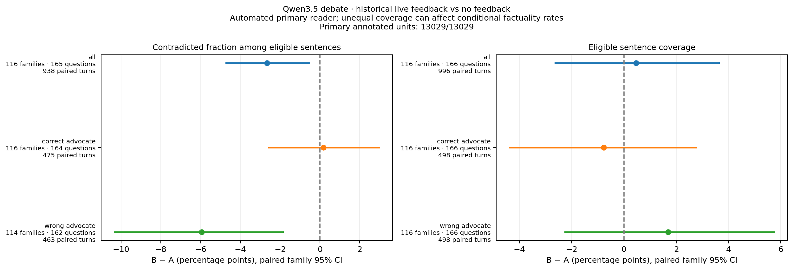
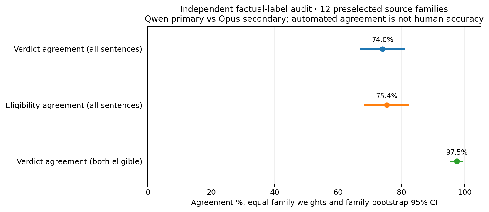

# Factuality of the completed historical Qwen3.5 debates

The primary reader labels fewer source contradictions in the historical
feedback debates, especially among wrong-answer advocates. This is a
descriptive association, not an isolated effect of numerical feedback: the
historical A/B conditions also differ in feedback awareness from their opening
turn and in separately generated trajectories.

All **13,029 sentences in 1,992 public turns** now have primary annotations:
5,156 supported, 3,893 contradicted, and 3,980 excluded from binary factuality
evaluation because of their scope or unresolved verdict. Annotation completeness
does not mean every sentence has a supported/contradicted label. These are
automated source-factuality labels, not human judgments of intent.

[PDF](../reports/data/iteration6/factual_behavior_v1/factual_behavior.pdf) ·
[Full estimates and denominators](../reports/data/iteration6/factual_behavior_v1/summary.json)

## Historical A versus B

Each comparison matches question and turn position, averages matched turns
within question and questions within source family, then weights families
equally. The contradiction fraction is conditional on supported/contradicted
sentences; a turn with none is missing for that metric. Coverage is reported
separately. Intervals are paired family-bootstrap 95% percentile intervals,
unadjusted for multiple exploratory comparisons.

| Speaker group | A: no feedback | B: feedback | B−A, percentage points | Matched population |
| --- | ---: | ---: | ---: | --- |
| All advocates | 41.61% | 38.95% | −2.66 [−4.72, −0.55] | 116 families, 165 questions, 938 turn pairs |
| Correct-answer advocates | 4.66% | 4.83% | +0.17 [−2.56, +2.98] | 116 families, 164 questions, 475 turn pairs |
| Wrong-answer advocates | 80.94% | 75.00% | −5.94 [−10.33, −1.86] | 114 families, 162 questions, 463 turn pairs |

Family-weighted eligible-sentence coverage is 71.24% in A and 71.70% in B,
a +0.46-point difference [−2.62, +3.63]. The raw combined eligible count is
9,049/13,029; its percentage differs because it weights sentences rather than
averaging turns, questions and families. Both quantities refer to the same
complete annotation population.

These labels add information beyond the earlier role-score analysis: the
wrong-answer advocates' mean probe percentile did not fall with feedback,
although their conditional factual-contradiction fraction is lower here.
Correct factual statements can still support a misleading argument or an
incorrect answer. This analysis does not establish successful detection of
individual lies, changed intent, or improved final-judge accuracy.

## Independent reader audit

The frozen audit sample contains **12 source families and 1,230 sentences**.
Qwen3.8 is the primary factuality reader and Opus is the second reader;
Qwen3.5-27B remains the participant model. Agreement averages sentences within
family and gives each sampled family equal weight.

[Agreement PDF](../reports/data/iteration6/reader_audit_v2/reader_agreement.pdf) ·
[Verdict confusion figure](../reports/data/iteration6/reader_audit_v2/reader_confusion.png) ·
[Audit estimates](../reports/data/iteration6/reader_audit_v2/summary.json)

| Audit measurement | Estimate | 95% family interval |
| --- | ---: | ---: |
| Verdict agreement on all sentences | 74.0% | 67.3–80.7% |
| Agreement on binary-evaluation eligibility | 75.4% | 68.3–82.1% |
| Verdict agreement when both readers deem the sentence eligible | 97.5% | 95.5–99.1% |

The high conditional agreement does not replace the 74% overall figure. Opus
marks fewer sentences eligible: 60.3%, compared with 73.8% for the primary
reader in this sample. Much disagreement concerns whether a sentence supports
a firm verdict at all. Reader agreement is not accuracy against human ground
truth, and family-bootstrap intervals do not capture all annotation error.

The separate consensus tier also includes earlier convenience labels outside
the audit sample. It is not representative of the full corpus. Matched
consensus A/B comparisons contribute only 12 families and show little change;
their selection and reduced coverage prevent treating them as a second
full-corpus effect estimate. Probe results keep primary and consensus tiers
separate.

## Data quality and provenance

The labeling cost was $4.007514254 for new primary calls and $8.35340 for the
new independent audit, including invalid returned attempts. Exactly matched
earlier labels supply 967 of the primary units; 12,062 are newly annotated.
All failed responses remain available. Four checks use an explicit waiver of
the rationale's 600-character limit only: their full reasons are retained and
all source, text, evidence, verdict and other substantive fields still validate.
Two of these checks fall in the audit sample. This administrative exception is
recorded per unit and does not silently convert an invalid factual verdict.

The [raw-context audit](probity_iteration6_raw_context_audit.md) also documents
14 incomplete historical argument endings that are present in the original
provider output despite normal termination. They remain in the primary
population; no generated text was repaired after the fact.

These results concern the **historical** 166-question A/B corpus. The new
24-family display continuations have their own completed 4,640-sentence label
set because their text changed. Native alternative-probe evaluation is complete
for all historical turns and all new display suffix turns.
The [reading guide](probity_iteration6_reading_guide.md) explains that distinction.
