# Probity analysis plots

[Download the 11-page PDF](figures/iteration3/analysis_plots_v1/probity_analysis_plots.pdf) · [Download all PNG, SVG and PDF exports](figures/iteration3/analysis_plots_v1/probity_analysis_plots.zip)

These figures use the completed pilot's audited aggregates. The independent unit is the original story family: 48 debate presentations cover 24 families, with both Qwen 27B debater models represented. Intervals resample families and are not adjusted for multiple comparisons. No new inference or statistical fitting was performed for this collection.

The [full results report](../docs/probity_iteration3_results.md) gives the methods and limitations. The [plot manifest](figures/iteration3/analysis_plots_v1/manifest.json) records every input hash, plotted summary and output hash.

## Primary judge comparisons

Uplift is real probe assistance minus the matched neutral display. The adapted response probe helps the small judge; the new local sentence display harms it. Both comparisons were prespecified.

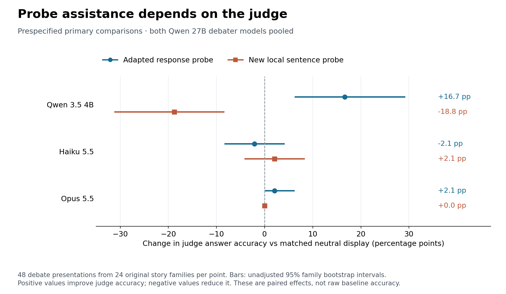

## Baseline accuracy and headroom

The high baseline refers to the judge's answer accuracy. Neutral displays have their own baselines, so subtracting the no-signal score would answer a different question.

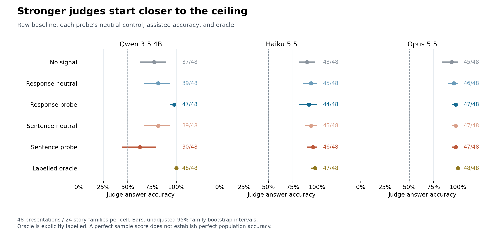

## All detector effects

Every measured pooled detector comparison is shown. FIBS covers Qwen 3.5 debaters only; Opus evaluated only the two primary signals. Unevaluated cells are distinct from zero effects.

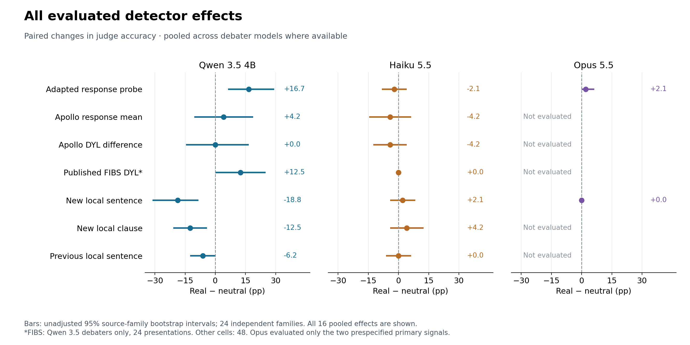

## Errors fixed and introduced

These are paired changes relative to each detector's neutral control. Unchanged answers are omitted. The denominator is 48 presentations except for the 24-presentation FIBS track.

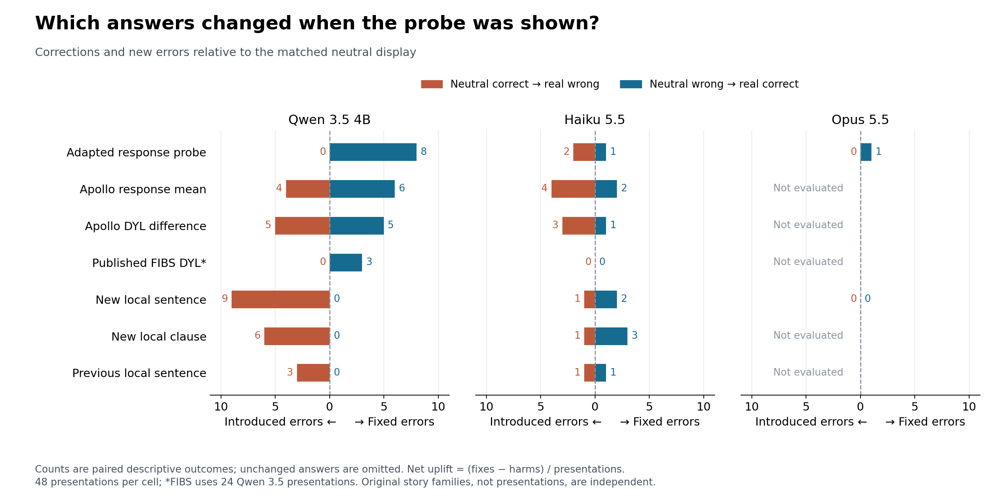

## Response role detection

These labels identify the assigned correct-answer or incorrect-answer role. They do not establish the truth of individual sentences or hidden intent.

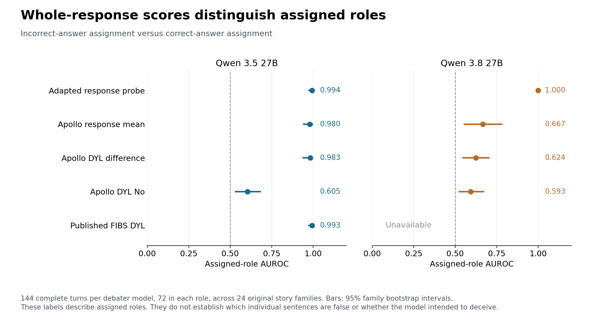

## Local truth label coverage

All 1,977 fixed sentence units remain in the denominator, including unknown and unaccepted labels. Accepted labels come from independent model judgments and evidence, not human ground truth.

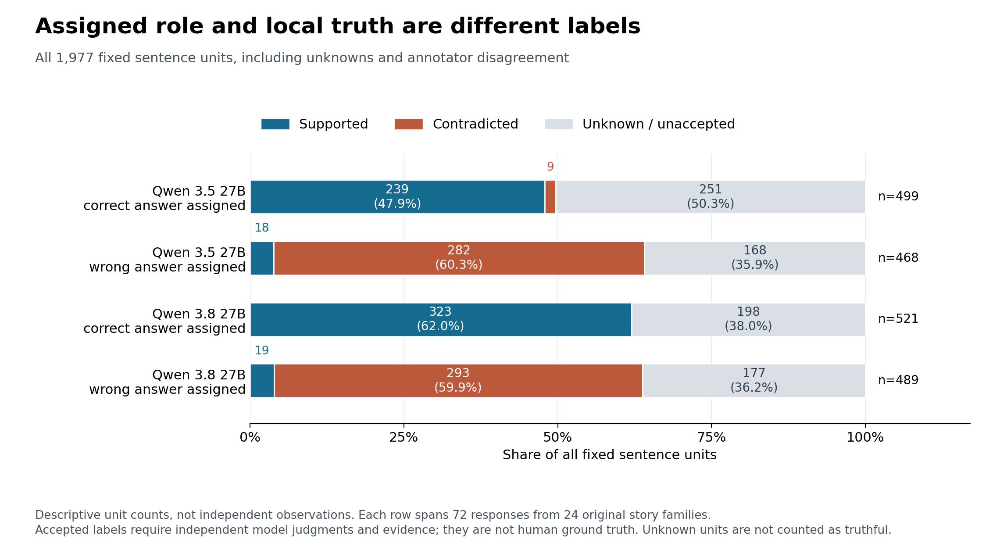

## Repeatability and cache reuse

Only Haiku supplies distinct generations of repeated identical requests in this comparison. Three of 265 answer pairs differ, within two of 97 prompt groups. Provider routing also varies; this is not an isolated measurement of sampling noise. Native cached agreement does not measure generation variability, and Opus has no identical-request repeats.

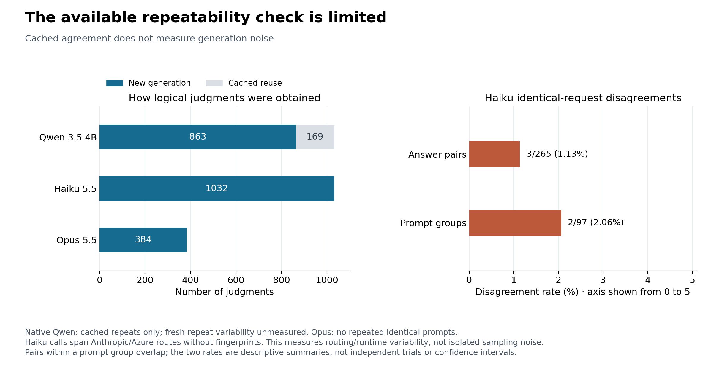

## Primary local sentence evaluation

The full control comparison uses within-response AUROC, averaged by original source family. Only responses with both accepted supported and contradicted units contribute: 15 responses across seven families for Qwen 3.5, and 13 across five families for Qwen 3.8. Pooled sentence AUROC would not establish localization.

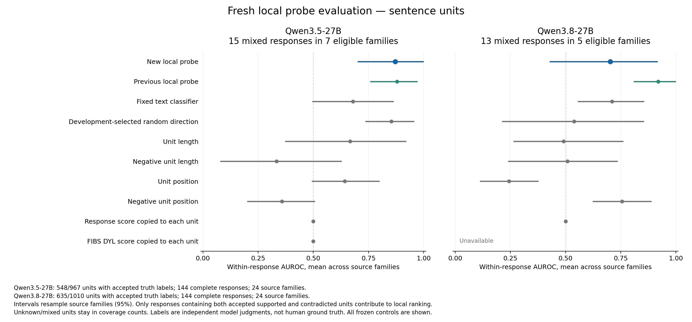

## Secondary opening-clause diagnostic

This is a separate descriptive evaluation of 771 clauses from 48 wrong-assigned opening responses. It is distinct from the all-turn clause displays used by judges. The new Qwen 3.5 probe performs better here, while Qwen 3.8 remains worse than the previous probe; this does not establish a general improvement in local detection or judge uplift.

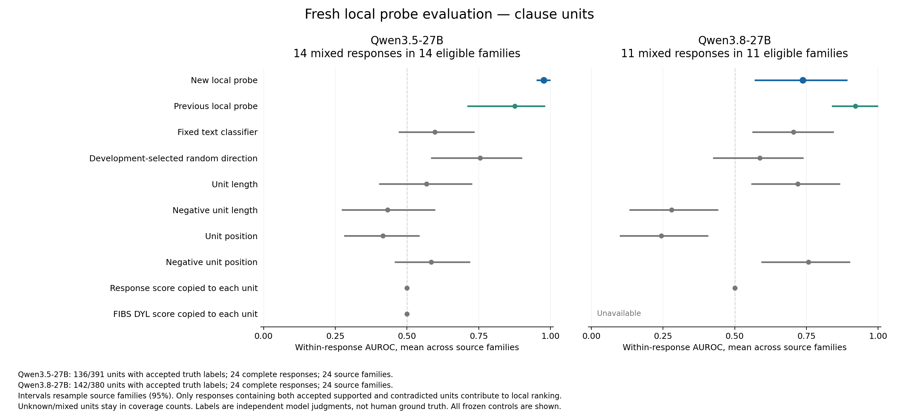

## Source controls

Corrected question-only and full-story controls distinguish answer-option cues from source comprehension. The short-option subgroup is shown separately; all original story families remain in the overall comparison.

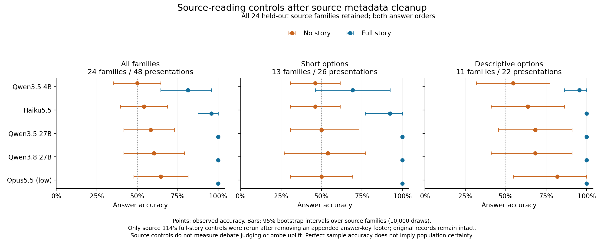

## Judge effects by debater model

These detailed panels preserve all frozen participant-specific effects and show raw baseline and oracle accuracy separately.

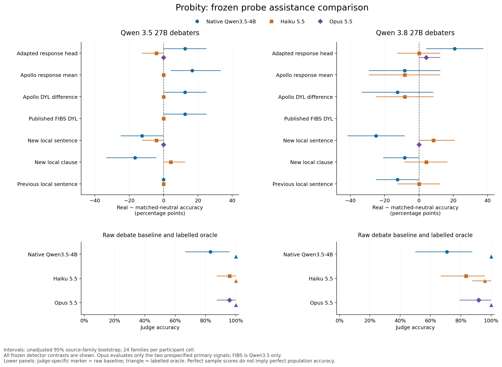

## Reproduction

From the repository root, use a fresh output directory:

```bash
python3 reports/plot_analysis_summary.py --out reproduced_analysis_plots
```

The renderer uses Matplotlib, NumPy, CairoSVG and PyMuPDF. It reads only the published aggregate files and the original detailed SVG figures. It checks effect arithmetic, family and presentation counts, and truth-label denominators before plotting. The PDF preserves vector figures; the ZIP includes PNG, SVG, PDF and the numeric manifest. Original experiment files and prior figures are unchanged.
